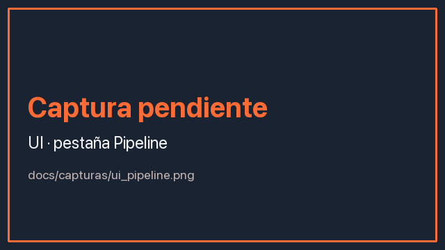
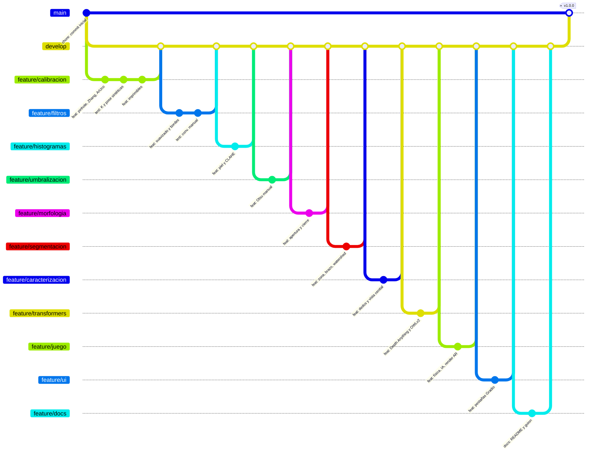
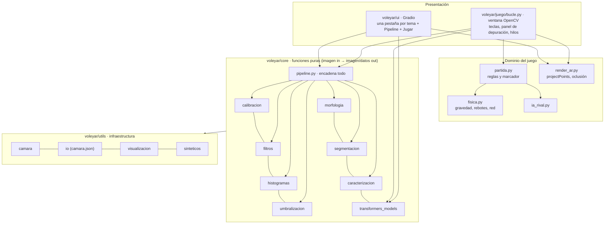

# Voley AR

**Proyecto final – Visión Artificial**
Autor: **Jorge Enrique Olaya Liévano** · Ingeniería de Sistemas, Pontificia Universidad Javeriana

Voley AR es un minijuego de voleibol en realidad aumentada sobre la mesa. Imprimes una mini cancha con marcadores
ArUco, la cámara web la reconoce y dibuja encima, en 3D, la red y un balón virtual que rebota. Juegas con tu propia
mano, sin ningún objeto: si tocas el balón, lo devuelves al otro lado, contra una IA rival simple, hasta 15 puntos.

La calibración de la cámara es indispensable: sin la matriz intrínseca `K` y la distorsión de **tu** cámara web, la
red y el balón no quedan pegados a la mesa. Cada tema del curso cumple una función real dentro del juego, y los
transformers se usan solo en inferencia, con pesos públicos de Hugging Face (no se entrena ni se etiqueta nada).

## Capturas

| | |
|---|---|
|  |  |
| *Partida con el panel de depuración (tecla D)* | *Con calibración (naranja) vs. sin calibración (blanco)* |
|  |  |
| *Pipeline paso a paso en la UI* | *Detección clásica vs. OWLv2 y profundidad* |

> Las imágenes de `docs/capturas/` son marcadores de posición: se reemplazan por capturas reales de la cámara (ver
> `docs/capturas/README.md`).

## Materiales para imprimir

Los PDF están en [`docs/imprimibles/`](docs/imprimibles/) y se regeneran con:

```bash
python scripts/generar_imprimibles.py
```

| Archivo | Contenido |
|---|---|
| `tablero.pdf` | Tablero de ajedrez de 10 × 7 cuadros (9 × 6 esquinas interiores), cuadro de 25 mm, con una regla de 10 cm para verificar la escala. |
| `cancha.pdf` | Cancha azul de 25 × 18 cm con línea central, líneas de ataque y 4 marcadores ArUco `DICT_4X4_50` (IDs 0-3) de 3 cm en las esquinas, con sus medidas en cm. |

**Cómo imprimir:**
1. Imprime en **tamaño carta** y en la ventana de impresión elige **"Tamaño real" / "100 %"**. No uses "Ajustar a la página".
2. Mide con una regla un cuadro del tablero (debe medir 25 mm) y el lado de un marcador ArUco (30 mm). Si el cuadro
   no mide 25 mm, usa la medida real al calibrar (`--cuadro`).
3. Pega el tablero sobre un cartón o una superficie rígida: tiene que quedar plano.
4. La cancha es **azul** a propósito, para que nunca se confunda con la piel. Ponla con el borde **TU LADO** hacia ti.

## Instalación

Requiere Python 3.11 o superior. Probado en macOS con Apple Silicon (usa MPS para los transformers) y una cámara web.

```bash
git clone <url-del-repositorio> Voley-AR
cd Voley-AR
python3.11 -m venv .venv
source .venv/bin/activate
pip install -r requirements.txt
```

Los modelos de Hugging Face (~100 MB para Depth Anything y ~600 MB para OWLv2) se descargan solos la primera vez que
se usan y quedan en `~/.cache/huggingface`. No se suben pesos al repositorio.

La primera vez que el juego abra la cámara, macOS pedirá permiso para la Terminal o VS Code
(*Ajustes del Sistema → Privacidad y seguridad → Cámara*).

## Cómo calibrar la cámara, paso a paso

1. Imprime `tablero.pdf` al 100 %, pégalo en un cartón y mide un cuadro con la regla.
2. Ejecuta la captura guiada (usa la misma captura de OpenCV que el juego, así la resolución coincide):

   ```bash
   python scripts/calibrar_camara.py --cuadro 2.5 --vistas 15
   ```

3. Mueve el tablero frente a la cámara. Un aviso indica cuándo se detecta y cuántas vistas llevas, y sugiere hacia
   dónde moverlo: esquinas de la imagen, inclinado unos 30° hacia adelante, atrás y a los lados, cerca y lejos.
   Las vistas casi iguales a otras se rechazan. Teclas: `ESPACIO` captura, `A` captura automática, `C` calibra,
   `R` reinicia y `Q` sale.
4. Con 15 vistas o más pulsa `C`. Se muestran `K`, los coeficientes de distorsión `[k1 k2 p1 p2 k3]` y el **error de
   reproyección RMS**: por debajo de 0.5 px es una buena calibración. El resultado se guarda en `config/camara.json`
   y lo cargan el juego y la UI al iniciar.
5. Comprueba la ventana "Original / Sin distorsión": las rectas cerca de los bordes deben quedar rectas.

También se puede calibrar desde la pestaña **Calibración** de la UI (cámara en vivo o 15 vistas sintéticas de
prueba). En la subpestaña **Cancha: con y sin calibración** se ve el balón y la red con la `K` calibrada y con la
`K` aproximada (f = ancho, centro en la mitad, sin distorsión), junto con el error de reproyección de las esquinas
ArUco en ambos modos.

## Cómo calibrar la piel y jugar

```bash
python jugar.py                    # cámara 0
python jugar.py --camara 1         # otra cámara
python jugar.py --sintetico        # sin cámara: la mano virtual sigue al mouse (0-5 dedos, W/S altura)
python jugar.py --sin-profundidad  # sin Depth Anything (más rápido)
python jugar.py --dificultad dificil
```

1. Pon la cancha impresa sobre el escritorio, de modo que la cámara vea los 4 marcadores y una franja de mesa detrás
   de tu borde, por donde entra el brazo.
2. Al iniciar aparece un **recuadro naranja** sobre tu lado de la cancha: cúbrelo con la palma y pulsa `ESPACIO`.
   Tras una cuenta de 1.5 s se calcula el histograma de tu piel.
3. Juega. **Mano abierta = remate** (fuerte y rasante), **un dedo = toque suave** (alto y corto), 2-3 dedos = golpe,
   puño = bloqueo. La dirección depende de hacia dónde muevas la mano. El golpe solo vale con la mano **cerca de la
   mesa** (según la profundidad) y con el balón de tu lado. Se permite un bote. Gana quien llegue a 15.

| Tecla | Acción |
|---|---|
| `ESPACIO` | capturar el color de la piel |
| `D` | panel de depuración: máscara de piel, contorno, casco convexo, punta del dedo, pose, vista cenital, profundidad y FPS |
| `C` | alternar con calibración / sin calibración |
| `L` | líneas virtuales de la cancha (para ver la alineación) |
| `O` | detector de la mano: clásico / OWLv2 |
| `P` | recalibrar la piel |
| `R` | reiniciar la partida |
| `Q` / `ESC` | salir |

## Laboratorio interactivo (UI)

```bash
python app.py            # http://127.0.0.1:7860
```

La UI es de Gradio y corre en local. Tiene una pestaña por tema (Calibración, Filtros, Histogramas, Umbralización,
Morfología, Segmentación, Caracterización y Transformers), más **Pipeline** y **Jugar**. Cada pestaña acepta:

- la **cámara web en vivo** (`gr.Image` con *streaming*),
- una **imagen subida**,
- o una **escena de ejemplo sintética**, con cámara, distorsión y pose conocidas, para usarla sin cámara.

Cada pestaña tiene sliders para los parámetros, el resultado junto a la original y un desplegable
**"¿Qué está pasando?"** con la teoría y las fórmulas. La pestaña **Pipeline** muestra cada paso sobre el mismo frame:
corrección de distorsión → pose → CLAHE → retroproyección de piel → umbral + morfología → contorno de la mano →
casco convexo y punta del dedo → posición en cm → render AR. La pestaña **Jugar** lanza el juego en su propia ventana.

## Despliegue en Hugging Face Spaces (ZeroGPU)

La misma UI corre como Space de Gradio con ZeroGPU:

```bash
hf auth login                                        # una vez
python scripts/desplegar_space.py --repo Jeol28/voley-ar
```

El script arma `dist/space/` (código, imprimibles, `despliegue/requirements.txt` y el README con su cabecera YAML),
crea el Space con hardware `zero-a10g` y lo sube. Diferencias de la versión en línea:

- **ZeroGPU:** `import spaces` va antes que torch (`voleyar/entorno.py`). Los modelos se cargan al arrancar y la
  inferencia va en funciones `@spaces.GPU` que reciben y devuelven solo datos
  (`transformers_models.estimar_profundidad` y `detectar_manos`). En local el decorador no hace nada.
- **Estado por sesión:** la calibración y la piel viven en el `gr.State` de cada visitante, no en variables
  globales ni en el disco del servidor. La calibración se descarga como `camara.json`.
- **Jugar en el navegador:** no hay ventana de OpenCV en el servidor, así que la pestaña Jugar recibe la cámara del
  navegador (`gr.Image` con streaming) y cada frame pasa por el mismo `Juego.paso` (`voleyar/juego/navegador.py`).
  Los botones reemplazan a las teclas.

## Estrategia de ramificación

Se usó un flujo tipo *Git Flow* simplificado:

- **`main`**: versión estable y entregable. Solo recibe merges desde `develop` y lleva el tag `v1.0.0`.
- **`develop`**: rama de integración. Cada tema entra aquí cuando sus pruebas pasan.
- **`feature/<tema>`**: una rama por módulo (`feature/calibracion`, `feature/filtros`, `feature/histogramas`,
  `feature/umbralizacion`, `feature/morfologia`, `feature/segmentacion`, `feature/caracterizacion`,
  `feature/transformers`, `feature/juego`, `feature/ui`, `feature/docs` y, después de la v1.0.0,
  `feature/despliegue`). Sale de `develop`, se trabaja con commits
  pequeños ([Conventional Commits](https://www.conventionalcommits.org/es/): `feat`, `fix`, `test`, `docs`, `chore`)
  y vuelve a `develop` con `git merge --no-ff`, para que cada tema quede visible como una unidad en el historial.



## Arquitectura

El código sigue una **arquitectura en capas**: cada capa solo llama a la de abajo.



- **`core/`** no importa nada de Gradio ni abre ventanas. Cada función recibe arreglos NumPy y devuelve arreglos o
  dataclasses, así que se puede probar con datos sintéticos de verdad conocida.
- **`juego/`** contiene las reglas, la física y el render. `partida.py` no sabe de cámaras: recibe una
  `EntradaJugador` (rayo, punto en cm, velocidad, gesto y si la mano está cerca de la mesa).
- **`ui/`** y **`juego/bucle.py`** son dos presentaciones distintas del **mismo** pipeline
  (`core/pipeline.py::procesar_frame`): lo que ves en la pestaña Pipeline es exactamente lo que usa el juego.
- **`utils/`** agrupa la infraestructura: cámara (AVFoundation), lectura y escritura de `config/camara.json`, texto con
  tildes sobre OpenCV y escenas sintéticas para pruebas, demos y el modo `--sintetico`.

### Pipeline de un frame

```mermaid
flowchart LR
    A["Frame BGR<br/>1280×720"] --> B["Reducción a 960 px<br/>+ corrección de distorsión<br/>(remap con K, d)"]
    B --> C["ArUco + solvePnP<br/>pose R, t"]
    C --> D["CLAHE (L de Lab)<br/>+ suavizado"]
    D --> E["Retroproyección H-S × Cr-Cb<br/>en la zona proyectada"]
    E --> F["Otsu manual<br/>+ apertura/cierre"]
    F --> G["Contorno de la mano<br/>(watershed si hay otra región)"]
    G --> H["Vista cenital métrica<br/>(homografía de la mesa)"]
    H --> I["Corte mano-brazo<br/>(transformada de distancia)"]
    I --> J["Casco convexo, defectos<br/>dedos, punta"]
    J --> K["Rayo ∩ z = 0 → cm<br/>velocidad cm/s"]
    K --> L["Golpe, física, IA"]
    L --> M["Render AR<br/>red, balón, sombra"]
    D -. cada 8 frames, hilo aparte .-> N["Depth Anything V2<br/>¿mano cerca de la mesa?"]
    N -.-> L
```



En el MacBook el pipeline completo tarda **≈ 10-15 ms por frame** a 960 px (medido en las escenas sintéticas). El
juego va a unos 20-30 FPS; el límite es la cámara y el dibujo, no la visión.

### Módulos y su papel en el juego

| Módulo | Qué hace | Cómo participa en el juego |
|---|---|---|
| `core/calibracion.py` | Modelo pinhole, captura guiada con control de variedad, `cv2.calibrateCamera` (Zhang), corrección de distorsión, ArUco (`ArucoDetector`) + `solvePnP`, modo "sin calibrar", rayo ∩ plano, vista cenital por homografía. | Pone la red y el balón sobre la cancha impresa y lleva la mano a centímetros. Sin la `K` real, todo flota. |
| `core/filtros.py` | Gaussiano, mediana, bilateral; Sobel y Canny; convolución manual (NumPy) vs. `cv2.filter2D`. | Limpia el ruido de la cámara antes de segmentar la piel y dibuja el borde de la mano. |
| `core/histogramas.py` | Histogramas H-S y Cr-Cb de la piel, retroproyección (`calcBackProject`), ecualización manual y de OpenCV, CLAHE. | Calibra tu color de piel con el recuadro y compensa los cambios de luz del cuarto. |
| `core/umbralizacion.py` | Rangos de piel en HSV y YCrCb, Otsu implementado a mano (curva σ²_B) vs. OpenCV, umbral adaptativo, métricas. | Convierte la retroproyección en la máscara binaria de la mano en cada frame. |
| `core/morfologia.py` | Erosión, dilatación, apertura, cierre y gradiente con elemento configurable; versiones manuales; relleno de huecos. | Quita los puntos sueltos y rellena los huecos de la máscara sin pegar los dedos. |
| `core/segmentacion.py` | Zona de búsqueda proyectada (cancha + franja del brazo), contornos, corte mano-brazo (transformada de distancia o ancho mínimo), watershed, máscara de la cancha. | Deja fuera la cara y el cuerpo, aísla la mano y la separa de otra región de color parecido. |
| `core/caracterizacion.py` | Área, perímetro, centroide, circularidad, solidez, excentricidad, Hu; casco convexo y defectos; conteo de dedos; punto de golpe; velocidad. | Decide el gesto (remate/toque/golpe/bloqueo), el punto de golpe en cm y la velocidad de la mano. |
| `core/transformers_models.py` | Depth Anything V2 y OWLv2 (carga única, MPS/CPU) y comparación clásico vs. transformer. | Valida que el golpe se haga con la mano cerca de la mesa; detector alternativo de la mano (tecla `O`). |
| `core/pipeline.py` | Encadena todo para un frame y mide el tiempo de cada etapa. | Es la única puerta de entrada del juego y de la UI al core. |
| `juego/fisica.py` | Partícula con gravedad de juego (140 cm/s²), rebote en la mesa y la red, tiros parabólicos que pasan la red. | El balón. |
| `juego/ia_rival.py` | Predice dónde interceptar, se mueve con velocidad limitada y devuelve con error gaussiano; 3 dificultades. | El rival. |
| `juego/partida.py` | Reglas: un toque por lado, un bote permitido, fuera, red, marcador a 15. | La lógica de la partida, probada sin cámara. |
| `juego/render_ar.py` | Red en malla, balón sombreado escalado por `f·R/z_c`, sombra, oclusión por la mano (z-buffer simplificado). | Lo que ves. |

### Decisiones de diseño que salieron de las pruebas

- **Vista cenital métrica.** Con la cámara oblicua, contar dedos en la imagen fallaba por el escorzo. Rectificar la
  máscara con la homografía de la mesa (otra vez la calibración) dejó el conteo en 90 de 90 casos sintéticos.
- **Cierre de 5 px.** Con 9 px los dedos juntos se pegaban: 45 de 90 aciertos frente a 90 de 90.
- **Transformada de distancia con borde.** OpenCV no trata el borde de la imagen como fondo, así que un brazo que
  salía del cuadro parecía más grueso que la palma. Se agrega un marco de ceros.
- **Watershed por grosor.** Se activa cuando queda pegada a la mano una región más gruesa que un dedo, no solo cuando
  el área es grande.
- **Depth Anything cada N frames, en un hilo.** Tarda unos 110 ms en MPS (frente a unos 33 ms por frame), y la altura
  de la mano cambia más despacio que su posición. El bucle nunca espera al modelo.

Más detalle en [`docs/arquitectura.md`](docs/arquitectura.md).

## Modelos transformer

| Modelo | Uso | Latencia medida (M-series, MPS) |
|---|---|---|
| [depth-anything/Depth-Anything-V2-Small-hf](https://huggingface.co/depth-anything/Depth-Anything-V2-Small-hf) | Profundidad relativa → puntaje de altura `s = (med(D_mano) − med(D_anillo)) / (P95 − P5 de la cancha)`. Si `s` supera 0.30, la mano está levantada y el golpe no vale. | ≈ 110 ms |
| [google/owlv2-base-patch16-ensemble](https://huggingface.co/google/owlv2-base-patch16-ensemble) | Detector de vocabulario abierto con la consulta `"a hand"`. Detector alternativo y comparación con el pipeline clásico (IoU, distancia en px y en cm, latencia). | ≈ 400-600 ms |

Solo se usan en inferencia y nunca se entrenan ni se ajustan.

## Pruebas

```bash
pytest -m "not lento"   # rápidas, sin descargas (~40 s)
pytest                  # todas, incluidas las que cargan los modelos de Hugging Face
```

Ninguna prueba necesita la cámara. Usan escenas sintéticas de verdad conocida:

- un tablero renderizado con una `K` y una distorsión conocidas, del que la calibración recupera `f` con menos de 2 % de error y `k1` con un error menor de 0.05;
- `solvePnP` recupera una pose conocida con menos de 1 cm y menos de 1°;
- el modo sin calibrar tiene más error de reproyección que el calibrado;
- Otsu manual igual a OpenCV; convolución manual igual a `filter2D`; erosión/dilatación manuales iguales a OpenCV;
- descriptores de forma iguales a `skimage.measure.regionprops`;
- conteo de dedos (0-5) en siluetas sintéticas y en perspectiva;
- física (rebote, red, fuera), trayectorias que pasan la red, reglas, IA y una partida completa sin ventana;
- la UI se construye y cada pestaña procesa cada escena de ejemplo.

## Limitaciones

- **Luz.** Con luz muy baja o de color (lámparas cálidas fuertes), la crominancia de la piel cambia. CLAHE ayuda,
  pero conviene recalibrar la piel (`P`) si cambia la iluminación.
- **Tonos de piel.** El modelo de piel se calibra con **tu** mano, así que no depende de un rango fijo. Aun así, con
  pieles muy oscuras y poca luz, o muy claras con luz saturada, la crominancia es menos fiable.
- **Mesas de madera.** La madera tiene un tono parecido a la piel. La zona de búsqueda (solo la cancha y la franja
  del brazo), la cancha azul y el histograma calibrado lo mitigan, pero sobre una mesa de madera clara la franja del
  brazo puede llenarse de "falsa piel". Mejor usar un mantel o una mesa de otro color.
- **La mano tapando la cancha.** Si la mano tapa marcadores, la pose se calcula con los que queden (basta uno) y, si
  no queda ninguno, se reutiliza la última pose hasta 20 frames. Ubica la cámara para que tu mano no tape los 4 a la vez.
- **Paralaje.** El punto de golpe en cm es la intersección del rayo con `z = 0`. Con la mano a 1-2 cm de la mesa, eso
  lo desplaza 1-2 cm. La colisión con el balón usa la distancia 3D entre el rayo y el balón, que no tiene ese sesgo.
- **Profundidad relativa.** Depth Anything no da centímetros; el umbral de altura (`--umbral-profundidad`) puede
  requerir ajuste según la cámara y la luz. Se validó con mapas sintéticos, no con una mano real.
- **Resolución de la calibración.** `K` vale para la resolución y la relación de aspecto con que se calibró. El
  código la escala si cambia la resolución, pero no si cambia el recorte (4:3 frente a 16:9).
- **OWLv2** es demasiado lento para jugar fluido (≈ 2 FPS). Sirve para comparar, no como detector principal.

## Estructura del repositorio

```
voleyar/
  core/      calibracion, filtros, histogramas, umbralizacion, morfologia, segmentacion,
             caracterizacion, transformers_models, pipeline, config
  juego/     fisica, ia_rival, partida, render_ar, asincrono, bucle, navegador
  ui/        app, tema, estado, comunes, pestanas/ (una por tema + pipeline + jugar)
  utils/     camara, io, visualizacion, sinteticos
config/      camara.json (lo crea la calibración)
scripts/     generar_imprimibles.py, calibrar_camara.py, desplegar_space.py
despliegue/  requirements.txt y cabecera del README para el Space
tests/       una prueba por módulo (+ juego y UI)
docs/        arquitectura.md, guion_video.md, imprimibles/, capturas/
app.py       lanza la UI
jugar.py     lanza el juego
```

## Licencia

[MIT](LICENSE) © 2026 Jorge Enrique Olaya Liévano
