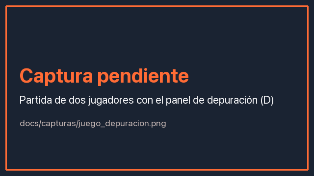
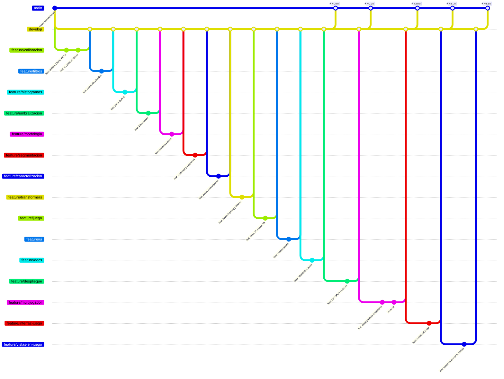
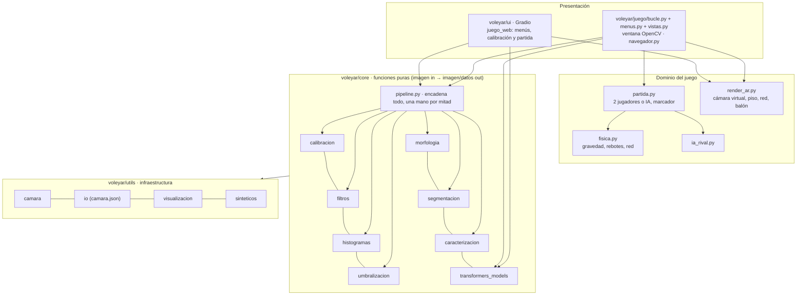
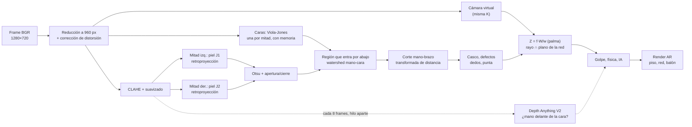

# Voley AR

**Proyecto final – Visión Artificial**
Autor: **Jorge Enrique Olaya Liévano** · Ingeniería de Sistemas, Pontificia Universidad Javeriana

Voley AR es un juego de voleibol en realidad aumentada para **dos jugadores frente a una misma cámara web** (o uno
contra la IA). No hay nada impreso ni ningún objeto: la cancha, la red y el balón se dibujan sobre la imagen de la
cámara, y lo único físico son las manos. La mitad izquierda de la imagen es del jugador 1, la derecha del jugador 2, y
la red queda en el centro. Cada uno golpea el balón con su mano para pasarlo al otro lado, hasta 15 puntos.

Cada tema del curso cumple una función real en el juego. La **calibración** de la cámara es la que une lo real con lo
virtual:

- corrige la distorsión de la lente;
- define la cámara virtual con la que se dibuja la cancha;
- permite medir a qué distancia de la cámara está cada mano (`Z = f·W/w`, con el tamaño de la palma). Con esa
  distancia se sabe si la mano está en el plano de juego.

Los transformers se usan solo en inferencia, con pesos públicos de Hugging Face (no se entrena ni se etiqueta nada).

**Pruébalo en línea:** [huggingface.co/spaces/Jeol28/Vision](https://huggingface.co/spaces/Jeol28/Vision)
(Gradio con ZeroGPU y video por WebRTC).

## Capturas

| | |
|---|---|
|  |  |
| *Partida de dos jugadores con el panel de depuración (tecla D)* | *Distancia de las manos con y sin calibración* |
|  |  |
| *Vista de morfología en plena partida* | *Vista de transformers: profundidad y OWLv2* |

> Las imágenes de `docs/capturas/` son marcadores de posición: se reemplazan por capturas reales de la cámara (ver
> `docs/capturas/README.md`).

## Cómo se juega

```
             cámara web
                 │
   ┌─────────────┼─────────────┐
   │ JUGADOR 1   │   JUGADOR 2 │   ← cada uno en su mitad de la imagen
   │   🖐        │        ☝    │
   │      🏐     │             │
   │═════════════╪═════════════│   ← piso de la cancha virtual
   └─────────────┴─────────────┘
                red
```

- **Modos:** `2j` (dos jugadores lado a lado) e `ia` (tú a la izquierda contra la IA a la derecha).
- **Gestos:**

  | Mano | Golpe | Punto de golpe |
  |---|---|---|
  | Abierta (4-5 dedos) | remate, fuerte y bajo | centro de la palma |
  | 2-3 dedos | golpe | punta del dedo |
  | 1 dedo | toque suave y alto | punta del dedo |
  | Puño | bloqueo | nudillos |

  La dirección y la distancia dependen de cómo muevas la mano.
- **Plano de juego:** al empezar se mide a qué distancia de la cámara está la mano de cada jugador. Un golpe solo vale
  si la mano está en ese plano, ni mucho más cerca ni mucho más lejos. En escritorio, Depth Anything además comprueba
  que la mano esté delante del cuerpo.
- **Reglas:** un toque por lado, un bote permitido, fuera o red es punto para el otro. Gana quien llegue a 15.
  **No se cruza la red:** cada mano solo se busca en su mitad.

## Instalación

Requiere Python 3.11 o superior. Probado en macOS con Apple Silicon (usa MPS para los transformers) y una cámara web.

```bash
git clone <url-del-repositorio> Voley-AR
cd Voley-AR
python3.11 -m venv .venv
source .venv/bin/activate
pip install -r requirements.txt
```

Los modelos de Hugging Face (~100 MB Depth Anything, ~600 MB OWLv2) se descargan solos la primera vez y quedan en
`~/.cache/huggingface`. No se suben pesos al repositorio. La primera vez que el juego abra la cámara, macOS pedirá
permiso para la Terminal o VS Code (*Ajustes del Sistema → Privacidad y seguridad → Cámara*).

## Material para imprimir

Solo hace falta **el tablero de calibración**. Está en [`docs/imprimibles/`](docs/imprimibles/) y se regenera con
`python scripts/generar_imprimibles.py`.

| Archivo | Contenido |
|---|---|
| `tablero.pdf` | Tablero de 10 × 7 cuadros (9 × 6 esquinas interiores), cuadro de 25 mm y regla de 10 cm. **Necesario.** |
| `cancha.pdf` | Cancha con 4 marcadores ArUco de la versión 1. El juego actual no la usa (la pose con `solvePnP` sigue en `core/calibracion.py` y en sus pruebas). |

Imprime en tamaño carta al **100 % ("Tamaño real")**, sin "Ajustar a la página". Mide un cuadro con una regla (25 mm)
y pega el tablero sobre cartón para que quede plano.

## Cómo calibrar la cámara, paso a paso

1. Ejecuta la captura guiada. Usa la misma captura de OpenCV que el juego, así la resolución coincide:

   ```bash
   python scripts/calibrar_camara.py --cuadro 2.5 --vistas 15
   ```

2. Mueve el tablero frente a la cámara. Un aviso indica cuándo se detecta y cuántas vistas llevas, y sugiere hacia
   dónde moverlo (esquinas de la imagen, inclinado unos 30°, cerca y lejos). Las vistas casi iguales se rechazan.
   Teclas: `ESPACIO` captura, `A` captura automática, `C` calibra, `R` reinicia, `Q` sale.
3. Con 15 vistas o más pulsa `C`. Se muestran `K`, `[k1 k2 p1 p2 k3]` y el **error de reproyección RMS** (por debajo de
   0.5 px es bueno). El resultado se guarda en `config/camara.json`, que carga el juego.
4. Comprueba la ventana "Original / Sin distorsión": las rectas cerca de los bordes deben quedar rectas.

También se puede calibrar desde el juego en el navegador (**Calibrar cámara**, en el menú de inicio). Durante la
partida, la vista **1 · Calibración** muestra la distancia de cada mano con la `K` calibrada y la que daría la
aproximada (f = ancho). En las pruebas: con calibración, 56 y 61 cm (reales: 60 y 64); sin calibración, 77 y 83 cm.

## Cómo jugar

Hay dos formas, con las mismas reglas y los mismos menús.

**En una ventana (lo más fluido):**

```bash
python jugar.py                    # abre el menú del juego
python jugar.py --modo 2j          # directo a una partida de dos jugadores
python jugar.py --sintetico        # sin cámara: el mouse mueve la mano del jugador 1
python jugar.py --sin-profundidad  # sin Depth Anything (más rápido)
```

**En el navegador:**

```bash
python app.py                      # http://127.0.0.1:7860 (o el Space en línea)
```

1. En el **menú de inicio** elige **Contra la IA** o **2 jugadores**. En **Ajustes** están la dificultad de la IA, los
   puntos para ganar (7, 11 o 15) y "Usar la calibración" (para comparar). Desde el inicio también se abren **Cómo se
   juega** y **Calibrar cámara**, que es un asistente con el tablero.
2. Pongan la cámara frente a ustedes, a unos 50-75 cm: el jugador 1 a la izquierda y el jugador 2 a la derecha.
3. Aparece un **recuadro naranja** en la mitad de cada jugador. Cúbranlo con la palma, a la distancia a la que van a
   jugar, y pulsen **¡Listo!** (o `ESPACIO` en la ventana): se aprende el color de la piel de cada uno.
4. Durante los primeros segundos se mide la distancia de cada mano (su plano de juego). A jugar. Al terminar,
   **Revancha** o **Menú principal**.

En la ventana todo se elige con el mouse o con la tecla que aparece en cada botón. Atajos durante la partida:

| Tecla | Acción |
|---|---|
| `ESPACIO` | capturar la piel de cada jugador |
| `ESC` | pausa: seguir, recalibrar la piel, reiniciar, menú principal o salir |
| `V` / `B` | siguiente / anterior tema: cómo te ve el juego, en vivo (ver la sección siguiente) |
| `[` / `]` | cambiar el ajuste del tema que se está viendo |
| `C` | con calibración / sin calibración |
| `O` | detector de la mano: clásico / OWLv2 |

En modo sintético: el mouse mueve la mano del jugador 1, `0`-`5` cambia sus dedos y `W`/`S` la acerca o la aleja. Con
dos jugadores, `I`/`J`/`K`/`L` mueve la mano del jugador 2 y `N` cambia sus dedos.

## Cada tema del curso, dentro del juego

No hay una aplicación ni un panel aparte para ver lo técnico: el propio juego lo muestra mientras se juega. En la
partida, **¿Qué quieres ver?** (o `V` / `B` en la ventana) pone un "lente" sobre la escena: el mundo del juego pasa a
verse como lo ve ese tema **en ese mismo frame** (la máscara de piel, los bordes, el mapa de profundidad…), con la
cancha, la red y el balón encima, y una tarjeta translúcida abajo con sus números reales. Con **− / +** (o `[` / `]`)
se cambia su ajuste principal y se ve el efecto sin dejar de jugar.

| Vista | Qué muestra en vivo | Ajuste con − / + |
|---|---|---|
| 1 · Calibración | La imagen de la lente con las rectas curvadas y la corregida; `f`, centro, `k1`, error de reproyección; la distancia de cada mano con y sin calibración. | usar la calibración |
| 2 · Filtros | La zona de las manos antes y después del suavizado, con los bordes de Canny; el ruido (σ del laplaciano) antes y después. | gaussiano / mediana / bilateral / ninguno |
| 3 · Histogramas | El histograma Cr-Cb de la piel de cada jugador y su retroproyección; el contraste antes y después de CLAHE. | clip de CLAHE |
| 4 · Umbralización | La curva de varianza entre clases de Otsu y el histograma de cada mitad, con el umbral T elegido; la máscara binaria. | umbral mínimo de Otsu |
| 5 · Morfología | La máscara antes y después de apertura + cierre; regiones, ruido quitado y huecos rellenados. | tamaño del cierre |
| 6 · Segmentación | Mano (blanco), brazo (naranja) y caras de Viola-Jones (rojo) en cada mitad; si se cortó el brazo o actuó el watershed. | corte por distancia o por ancho |
| 7 · Caracterización | La silueta de cada mano con casco convexo, valles y puntas; dedos, gesto, área en cm², solidez y circularidad. | umbral de los dedos (k·r) |
| 8 · Transformers | El mapa de profundidad de Depth Anything y las cajas de OWLv2; latencias y si cada mano está delante de su cara. | jugar con OWLv2 |

Las vistas también funcionan durante la calibración de la piel: la de Histogramas muestra el modelo recién
aprendido.

## Despliegue en Hugging Face Spaces (ZeroGPU)

```bash
hf auth login                                        # una vez
python scripts/desplegar_space.py --repo Jeol28/Vision
```

El script arma `dist/space/` (código, imprimibles, `despliegue/requirements.txt` y el README con su cabecera YAML) y lo
sube al Space con hardware `zero-a10g`. Diferencias de la versión en línea:

- **ZeroGPU:** `import spaces` va antes que torch (`voleyar/entorno.py`). Los modelos se cargan al arrancar y la
  inferencia va en funciones `@spaces.GPU` que solo reciben y devuelven datos (`estimar_profundidad`,
  `detectar_manos`). En local el decorador no hace nada.
- **Estado por sesión:** la calibración y la piel de cada visitante viven en su `gr.State`, no en el disco del servidor.
  La calibración se descarga como `camara.json`.
- **Jugar en el navegador por video (WebRTC):** la página usa el componente `WebRTC` de
  [fastrtc](https://github.com/gradio-app/fastrtc). El navegador transmite la cámara como un video continuo y
  comprimido (como una videollamada, no como fotos); cada frame pasa por el mismo `Juego.paso` y el video del juego
  vuelve por el mismo canal a ~30 FPS. Si el servidor se atrasa, se descartan los frames viejos. Unos botones
  reemplazan a las teclas; el video y los botones comparten el juego de cada visitante mediante una clave de sesión
  (`voleyar/ui/sesiones.py`). La calibración de la cámara también va por video.
- **Servidor TURN:** en un Space, WebRTC necesita un relé TURN. fastrtc lo pide a Hugging Face con un token guardado
  como secreto `HF_TOKEN` del Space (*Settings → Variables and secrets*). En local no hace falta.

## Estrategia de ramificación

Se usó un flujo tipo *Git Flow* simplificado:

- **`main`**: versiones estables y entregables (tags `v1.0.0`, `v1.1.0`, `v2.0.0`, `v2.1.0` y `v2.2.0`). Solo recibe merges desde `develop`.
- **`develop`**: rama de integración. Cada tema entra cuando sus pruebas pasan.
- **`feature/<tema>`**: una rama por módulo. Para la v1: `feature/calibracion`, `feature/filtros`,
  `feature/histogramas`, `feature/umbralizacion`, `feature/morfologia`, `feature/segmentacion`,
  `feature/caracterizacion`, `feature/transformers`, `feature/juego`, `feature/ui` y `feature/docs`. Después vinieron
  `feature/despliegue` (v1.1.0), `feature/multijugador` (v2.0.0), `feature/interfaz-juego` (v2.1.0) y
  `feature/vistas-en-juego` (v2.2.0). Cada rama sale de `develop`, se trabaja con commits
  pequeños ([Conventional Commits](https://www.conventionalcommits.org/es/)) y vuelve con `git merge --no-ff`.



## Arquitectura

El código sigue una **arquitectura en capas**: cada capa solo llama a la de abajo.



- **`core/`** no importa nada de Gradio ni abre ventanas: recibe arreglos NumPy y devuelve arreglos o dataclasses, así
  que se prueba con escenas sintéticas de verdad conocida.
- **`juego/`** contiene reglas, física y render. `partida.py` no sabe de cámaras: recibe una `EntradaJugador` por mano
  (rayo, punto en el plano, velocidad, gesto y si la mano está en el plano de juego).
- **`ui/`**, **`juego/bucle.py`** y **`juego/navegador.py`** son presentaciones del **mismo** pipeline
  (`core/pipeline.py::procesar_frame`).
- **`utils/`** agrupa la infraestructura: cámara (AVFoundation), `config/camara.json`, texto con tildes sobre OpenCV y
  escenas sintéticas.

### Pipeline de un frame



El pipeline de las dos manos tarda **≈ 20-25 ms por frame** a 960 px (la cascada Haar corre cada 3 frames).

### Módulos y su papel en el juego

| Módulo | Qué hace | Cómo participa en el juego |
|---|---|---|
| `core/calibracion.py` | Pinhole, captura guiada, `cv2.calibrateCamera` (Zhang), corrección de distorsión, cámara virtual, `Z = f·W/w`, rayo ∩ plano; ArUco + `solvePnP` de la v1 (ya no lo usa el juego). | Hace coincidir las manos reales con la cancha virtual y mide la distancia de cada mano. Sin la `K` real, la distancia y la geometría salen mal. |
| `core/filtros.py` | Gaussiano, mediana, bilateral; Sobel y Canny; convolución manual vs. `filter2D`. | Limpia el ruido de la cámara antes de segmentar la piel. |
| `core/histogramas.py` | Histogramas H-S y Cr-Cb, retroproyección, ecualización, CLAHE. | Un modelo de piel **por jugador** (tonos distintos) y compensación de la luz. |
| `core/umbralizacion.py` | Rangos HSV/YCrCb, Otsu manual (curva σ²_B) vs. OpenCV, adaptativo, métricas. | Convierte la retroproyección de cada mitad en la máscara de la mano. |
| `core/morfologia.py` | Erosión, dilatación, apertura, cierre, gradiente; versiones manuales; relleno de huecos. | Quita los puntos sueltos sin pegar los dedos (cierre de 5 px). |
| `core/segmentacion.py` | Mitades por jugador, caras (Viola-Jones), contornos, corte mano-brazo, watershed con marcadores mano-cara. | Aísla la mano de cada jugador aunque pase por delante de su cara. |
| `core/caracterizacion.py` | Área, perímetro, centroide, circularidad, solidez, excentricidad, Hu; casco convexo y defectos; dedos; velocidad. | Decide el gesto (remate, golpe, toque o bloqueo), el punto de golpe y la velocidad de la mano. |
| `core/transformers_models.py` | Depth Anything V2 y OWLv2 (carga única, MPS/CPU/ZeroGPU), comparación clásico vs. transformer. | Verifica que la mano esté delante del cuerpo; detector alternativo (tecla `O`). |
| `core/pipeline.py` | Encadena todo para un frame y las dos mitades, y mide cada etapa. | Única puerta de entrada del juego y de la UI al core. |
| `juego/fisica.py` | Partícula con gravedad de juego, rebotes, tiros que pasan la red. | El balón. |
| `juego/ia_rival.py` | Predice dónde interceptar y devuelve con error; 3 dificultades. | El rival en modo `ia`. |
| `juego/partida.py` | Reglas para dos humanos o humano vs. IA, marcador a 15. | La lógica de la partida, probada sin cámara. |
| `juego/render_ar.py` | Piso en perspectiva, red frontal en malla, balón sombreado (`f·R/z_c`), sombra, HUD. | Lo que ven los jugadores. |

### Decisiones de diseño que salieron de las pruebas

- **La cara no se recorta de la zona de búsqueda.** Al principio se excluía la cara, pero el balón vuela a esa altura
  y la mano pasa por delante: la exclusión le cortaba la palma y la distancia se disparaba (101 cm en lugar de 60).
  Ahora solo se descartan las regiones que son casi solo cara (menos del 25 % fuera de ella). Si la mano la toca, un
  watershed con marcadores (núcleo de la cara por Haar y picos de la mano) separa ambas.
- **Una cara por mitad, grande, con memoria.** Haar daba falsos positivos sobre las manos. Se conserva la cara más
  grande de cada mitad (al menos el 20 % de la altura) y se recuerda unos 3 s si la mano la tapa.
- **Radio efectivo de la palma (3.5 cm).** La apertura morfológica se come el borde de la palma: con 4 cm, `Z` salía
  15 % alta. Con 3.5 cm el error en las escenas sintéticas quedó entre -4 % y +4 %.
- **Cierre de 5 px.** Con 9 px los dedos juntos se pegaban y el conteo fallaba.
- **Depth Anything cada N frames, en un hilo.** Tarda unos 110 ms en MPS; el bucle nunca lo espera.
- **Red frontal.** Vista de lado, la red (plano `x = 0`) se ve de canto: se dibuja como una franja de malla de frente.

Más detalle en [`docs/arquitectura.md`](docs/arquitectura.md).

## Modelos transformer

| Modelo | Uso | Latencia medida (M-series, MPS) |
|---|---|---|
| [depth-anything/Depth-Anything-V2-Small-hf](https://huggingface.co/depth-anything/Depth-Anything-V2-Small-hf) | Profundidad relativa: `s = (med(D_mano) − med(D_cara)) / (P95 − P5 de la mitad)`. Si la mano queda detrás de la cara de su jugador, el golpe no vale. | ≈ 110 ms |
| [google/owlv2-base-patch16-ensemble](https://huggingface.co/google/owlv2-base-patch16-ensemble) | Detector de vocabulario abierto con `"a hand"`, asignado a cada mitad. Comparación con el pipeline clásico (IoU, distancia en px y cm, latencia). | ≈ 400-600 ms |

## Pruebas

```bash
pytest -m "not lento"   # rápidas, sin descargas (~50 s)
pytest                  # todas, incluidas las que cargan los modelos de Hugging Face
```

Ninguna necesita la cámara: usan escenas sintéticas de verdad conocida.

- **Calibración y geometría:**
  - la calibración recupera `K` (error < 2 %) y la distorsión de un tablero renderizado;
  - `solvePnP` recupera la pose;
  - la cámara virtual deja la red al centro y el piso en su fila;
  - `Z = f·W/w` con y sin calibración (sin calibrar, el error es más del doble).
- **Equivalencia con bibliotecas:** Otsu manual = OpenCV, convolución manual = `filter2D`, erosión y dilatación
  manuales = OpenCV, descriptores = `skimage.measure.regionprops`.
- **Segmentación y caracterización:**
  - conteo de dedos en siluetas y en los ejemplos de dos jugadores;
  - cara detectada (una por mitad) y su memoria;
  - watershed mano-cara;
  - cada mano solo en su mitad.
- **Juego:** física, reglas para 2 jugadores, IA, render, partidas completas sin ventana en ambos modos y el juego del
  navegador con los manejadores de Gradio.
- **Menús, vistas y web:** el menú de escritorio (inicio, ajustes, pausa, revancha, clic del mouse); cada vista por
  tema aparece en la partida y su ajuste cambia el pipeline; la página web (botón de modo, stream de la cámara,
  botones, selector de temas y calibración guiada).

## Limitaciones

- **Luz y ropa.** La segmentación es por color de piel: con luz de color o ropa en tonos piel, aparecen regiones
  falsas. Se recomiendan buena luz blanca y mangas largas oscuras; si cambia la luz, recalibren la piel (`P`).
- **Tonos de piel.** Cada jugador calibra la suya, así que no hay un rango fijo. Pero la cascada Haar detecta peor las
  caras de piel oscura: en las escenas sintéticas no encontró la del jugador 2. En ese caso la mano se sigue
  eligiendo por el antebrazo que entra por abajo, pero si la mano toca esa cara no se puede separar.
- **Mano sobre la cara.** La posición y la distancia se mantienen (64 cm frente a 60 reales), pero los dedos que caen
  sobre la cara se confunden con ella: el gesto deja de ser fiable mientras la mano la tapa.
- **Distancia.** A más de ~75 cm cada dedo ocupa pocos píxeles y el conteo falla más (la mayoría de los errores de las
  pruebas fueron a 79 cm). `Z` depende de que el radio de la palma de cada jugador se parezca al promedio (3.5 cm
  efectivos); por eso el golpe se valida contra la distancia de referencia **de cada jugador**, no contra un valor fijo.
- **No cruzar la red.** Cada mano se busca solo en su mitad de la imagen: si cruza al otro lado, se corta.
- **Profundidad relativa.** Depth Anything no da centímetros y sobre manos reales no se ha validado aún; los
  centímetros vienen de la calibración.
- **Resolución de la calibración.** `K` vale para la resolución y la relación de aspecto con que se calibró.
- **OWLv2** va a unos 2 FPS: sirve para comparar, no para jugar.
- **La versión en línea depende de la red.** La cámara viaja como video por WebRTC hasta el servidor del Space (en
  EE. UU.) y el video del juego vuelve por el mismo canal. El servidor procesa un frame en ~30 ms y descarta los
  frames viejos, así que el retraso no se acumula, pero sigue existiendo el tiempo de ida y vuelta. Por eso en línea
  el balón cae un poco más lento y el golpe tiene algo más de alcance. La versión de escritorio (`python jugar.py`)
  procesa todo en tu equipo, sin red.

## Estructura del repositorio

```
voleyar/
  core/      calibracion, filtros, histogramas, umbralizacion, morfologia, segmentacion,
             caracterizacion, transformers_models, pipeline, config
  juego/     fisica, ia_rival, partida, render_ar, asincrono, bucle, menus, vistas (un tema por vista), navegador
  ui/        app, juego_web (la página del juego), calibracion_web, tema, estado, comunes
  utils/     camara, io, visualizacion, sinteticos
  entorno.py detección de Spaces/ZeroGPU
config/      camara.json (lo crea la calibración)
scripts/     generar_imprimibles.py, calibrar_camara.py, desplegar_space.py
despliegue/  requirements.txt y cabecera del README para el Space
tests/       pruebas por módulo, modo pantalla, juego y UI
docs/        arquitectura.md, guion_video.md, imprimibles/, capturas/
app.py       el juego en el navegador
jugar.py     el juego en una ventana
```

## Licencia

[MIT](LICENSE) © 2026 Jorge Enrique Olaya Liévano
