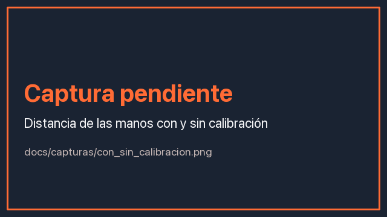
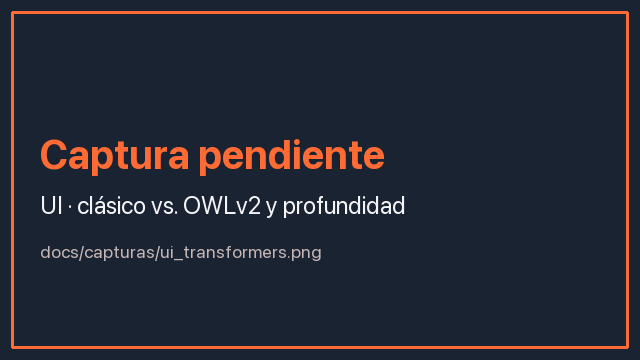
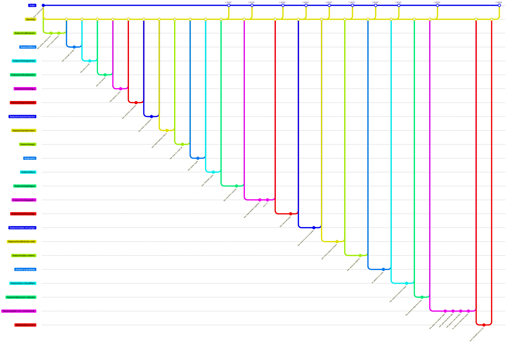
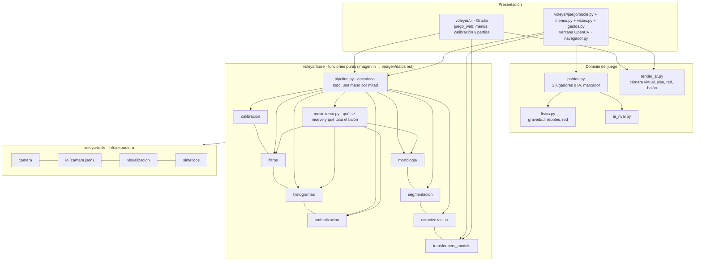
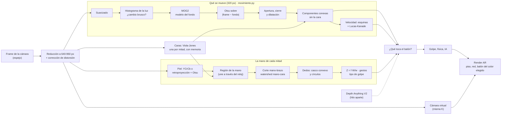

# Voley AR

**Proyecto final – Visión Artificial**
Autor: **Jorge Enrique Olaya Liévano** · Ingeniería de Sistemas, Pontificia Universidad Javeriana

Voley AR es un juego de voleibol en realidad aumentada para **dos jugadores frente a una misma cámara web** (o uno
contra la IA). No hay nada impreso ni ningún objeto: la cancha, la red y el balón se dibujan sobre la imagen de la
cámara, y lo único físico son las manos de los jugadores (o lo que usen para golpear). La mitad izquierda de la imagen
es del jugador 1, la derecha del jugador 2, y la red queda en el centro. Cada uno devuelve el balón al otro lado, hasta
15 puntos.

**Cada tema del curso decide algo de la partida** (no hay un laboratorio aparte): la calibración mide la distancia de
la mano y detecta el remate, los filtros miden la velocidad del golpe, los histogramas eligen el color del balón, la
umbralización y la segmentación deciden qué se mueve y qué no, la morfología fija la zona de golpe, la caracterización
lee los gestos de la mano y el tipo de golpe, y los transformers descartan lo que pasa lejos. Cada tema se puede ver
en vivo durante la partida ([ver tabla](#cada-tema-del-curso-dentro-del-juego)).

Los transformers se usan solo en inferencia, con pesos públicos de Hugging Face (no se entrena ni se etiqueta nada).

**Versión actual: v2.5.0.** El juego se usa en local (`python app.py` o `python jugar.py`). Hay una versión en línea en
[huggingface.co/spaces/Jeol28/Vision](https://huggingface.co/spaces/Jeol28/Vision) (Gradio con ZeroGPU y video por
WebRTC), pero corre una versión anterior y su video necesita un servidor TURN (ver
[Despliegue](#despliegue-en-hugging-face-spaces-zerogpu)).

## Capturas

| | |
|---|---|
|  |  |
| *Partida de dos jugadores con el panel de depuración (tecla D)* | *Distancia de las manos con y sin calibración* |
|  |  |
| *Vista de morfología en plena partida* | *Vista de transformers: profundidad y OWLv2* |

> Las imágenes de `docs/capturas/` son marcadores de posición: se reemplazan por capturas reales de la cámara (ver
> `docs/capturas/README.md`).

## Cómo se juega

```
             cámara web
                 │
   ┌─────────────┼─────────────┐
   │ JUGADOR 1   │   JUGADOR 2 │   ← cada uno en su mitad de la imagen
   │   🖐        │        ☝    │
   │      🏐     │             │
   │═════════════╪═════════════│   ← piso de la cancha virtual
   └─────────────┴─────────────┘
                red
```

- **Modos:** `2j` (dos jugadores lado a lado) e `ia` (tú a la izquierda contra la IA a la derecha).
- **Con qué se golpea:** con cualquier cosa que se mueva y no sea parte del cuarto: la mano, un cuaderno, una raqueta.
  Lo que lleva quieto unos segundos es entorno y no golpea; la cara tampoco cuenta.
- **Tipos de golpe** (los decide la caracterización de lo que toca el balón):

  | Qué toca el balón | Golpe | Cómo vuela |
  |---|---|---|
  | La mano, avanzando rápido hacia la cámara (> 60 cm/s) | **¡Remate!** | bajo, rápido y al fondo |
  | Puño (0-1 dedos) | **Golpe fuerte** | largo |
  | Mano con 2-3 dedos, o un objeto pequeño | **Golpe** | según la velocidad del golpe |
  | Mano abierta (4-5 dedos) | **Toque suave** | alto y corto |
  | Un objeto grande y compacto (un cuaderno) | **Bloqueo** | rebota corto, detrás de la red |

  Además, si lo que golpea viene muy rápido, el golpe sale **"¡rapidísimo!"**: más lejos y más bajo.

- **Gestos** (mano quieta medio segundo; un anillo alrededor de la mano se va llenando):

  | Gesto | Qué hace |
  |---|---|
  | ✋ Mano abierta | sacar |
  | Pulgar e índice en L | pausa / seguir |
  | ☝ Un dedo arriba (también 👍) | revancha, al terminar |
  | ✌ Dos dedos juntos | cambiar el tema que se ve |

- **El balón cambia de color** para resaltar siempre sobre el cuarto (el que menos aparece en la imagen).
- **Plano de juego:** al empezar se mide a qué distancia de la cámara está la mano de cada jugador; si golpea solo con
  la mano reconocida (sin moverla), el golpe vale si la mano está en ese plano.
- **Reglas:** un toque por lado, un bote permitido, fuera o red es punto para el otro. Gana quien llegue a 15.
  **No se cruza la red:** cada jugador solo golpea el balón en su mitad.

## Instalación

Requiere Python 3.11 o superior. Probado en macOS con Apple Silicon (usa MPS para los transformers) y una cámara web.

```bash
git clone <url-del-repositorio> Voley-AR
cd Voley-AR
python3.11 -m venv .venv
source .venv/bin/activate
pip install -r requirements.txt
```

Los modelos de Hugging Face (~100 MB Depth Anything, ~600 MB OWLv2) se descargan solos la primera vez y quedan en
`~/.cache/huggingface`. No se suben pesos al repositorio. La primera vez que el juego abra la cámara, macOS pedirá
permiso para la Terminal o VS Code (*Ajustes del Sistema → Privacidad y seguridad → Cámara*).

## Material para imprimir

Solo hace falta **el tablero de calibración**. Está en [`docs/imprimibles/`](docs/imprimibles/) y se regenera con
`python scripts/generar_imprimibles.py`.

| Archivo | Contenido |
|---|---|
| `tablero.pdf` | Tablero de 10 × 7 cuadros (9 × 6 esquinas interiores), cuadro de 25 mm y regla de 10 cm. **Necesario.** |
| `cancha.pdf` | Cancha con 4 marcadores ArUco de la versión 1. El juego actual no la usa (la pose con `solvePnP` sigue en `core/calibracion.py` y en sus pruebas). |

Imprime en tamaño carta al **100 % ("Tamaño real")**, sin "Ajustar a la página". Mide un cuadro con una regla (25 mm)
y pega el tablero sobre cartón para que quede plano.

## Cómo calibrar la cámara, paso a paso

1. Ejecuta la captura guiada. Usa la misma captura de OpenCV que el juego, así la resolución coincide:

   ```bash
   python scripts/calibrar_camara.py --cuadro 2.5 --vistas 15
   ```

2. Mueve el tablero frente a la cámara. Un aviso indica cuándo se detecta y cuántas vistas llevas, y sugiere hacia
   dónde moverlo (esquinas de la imagen, inclinado unos 30°, cerca y lejos). Las vistas casi iguales se rechazan.
   Teclas: `ESPACIO` captura, `A` captura automática, `C` calibra, `R` reinicia, `Q` sale.
3. Con 15 vistas o más pulsa `C`. Se muestran `K`, `[k1 k2 p1 p2 k3]` y el **error de reproyección RMS** (por debajo de
   0.5 px es bueno). El resultado se guarda en `config/camara.json`, que carga el juego.
4. Comprueba la ventana "Original / Sin distorsión": las rectas cerca de los bordes deben quedar rectas.

También se puede calibrar desde el juego en el navegador (**Calibrar cámara**, en el menú de inicio). Durante la
partida, la vista **1 · Calibración** muestra la distancia de cada mano con la `K` calibrada y la que daría la
aproximada (f = ancho). En las pruebas: con calibración, 56 y 61 cm (reales: 60 y 64); sin calibración, 77 y 83 cm.

## Cómo jugar

Hay dos formas, con las mismas reglas y los mismos menús.

**En una ventana (lo más fluido):**

```bash
python jugar.py                    # abre el menú del juego
python jugar.py --modo 2j          # directo a una partida de dos jugadores
python jugar.py --sintetico        # sin cámara: el mouse mueve la mano del jugador 1
python jugar.py --sin-profundidad  # sin Depth Anything (más rápido)
```

**En el navegador:**

```bash
python app.py                      # http://127.0.0.1:7860 (o el Space en línea)
```

1. En el **menú de inicio** elige **Contra la IA** o **2 jugadores**. En **Ajustes** están la dificultad de la IA, los
   puntos para ganar (7, 11 o 15) y "Usar la calibración" (para comparar). Desde el inicio también se abren **Cómo se
   juega** y **Calibrar cámara**, que es un asistente con el tablero.
2. Pongan la cámara frente a ustedes, a unos 50-75 cm: el jugador 1 a la izquierda y el jugador 2 a la derecha.
3. Se juega de una, sin calibrar nada: muevan la mano (o un cuaderno, o lo que quieran) sobre el balón para
   devolverlo. Lo quieto es parte del cuarto y no golpea.
4. Para sacar, abran la mano quieta medio segundo (o golpeen el balón). Con la L de pulgar e índice se pausa, y al
   terminar un dedo arriba pide la revancha. También hay botones: **Pausa / Seguir**, **Reiniciar**, **Revancha** y
   **Menú principal**.
5. El color de la piel se aprende solo: mientras no hay histograma propio se usa el rango fijo de YCrCb, y en cuanto
   una mano se confirma (forma + movimiento + histéresis) sus píxeles construyen los histogramas H-S y Cr-Cb de ese
   jugador, que se refrescan cada 30 frames. Durante los primeros segundos también se mide la distancia de cada mano
   (su plano de juego).

En la web, junto a los botones − / + hay un botón **Guardar foto de mi mano** (solo en local): guarda el frame, la
silueta de cada mano y lo que el juego leyó en `capturas_mano/`, una carpeta que no entra al repositorio. Sirve para
afinar los gestos con fotos reales.

En la ventana todo se elige con el mouse o con la tecla que aparece en cada botón. Atajos durante la partida:

| Tecla | Acción |
|---|---|
| `ESC` | pausa: seguir, reiniciar, menú principal o salir |
| `V` / `B` | siguiente / anterior tema: cómo te ve el juego, en vivo (ver la sección siguiente) |
| `[` / `]` | cambiar el ajuste del tema que se está viendo |
| `C` | con calibración / sin calibración |
| `O` | detector de la mano: clásico / OWLv2 |

En modo sintético: el mouse mueve la mano del jugador 1, `0`-`5` cambia sus dedos y `W`/`S` la acerca o la aleja. Con
dos jugadores, `I`/`J`/`K`/`L` mueve la mano del jugador 2 y `N` cambia sus dedos.

## Cada tema del curso, dentro del juego

Cada tema del curso **decide algo de la partida**, y su lente lo muestra mientras se juega. En la partida, **¿Qué
quieres ver?** (o `V` / `B` en la ventana) pone ese tema sobre la imagen de la cámara, con la cancha, la red y el balón
siempre encima. Sus números y gráficas van **fuera de la cancha**: en la columna izquierda de la web (se actualizan cada
segundo) o en una franja debajo del video en la ventana, así nunca tapan el balón. Con **− / +** (o `[` / `]`) se
cambia su ajuste y se nota en el juego.

| Tema | Qué decide en la partida | Si lo cambias o lo quitas | Ajuste con − / + |
|---|---|---|---|
| 1 · Calibración | La distancia de la mano, `Z = f·W/w`, y su velocidad hacia la cámara: más de 60 cm/s es un **remate**. Corrige la distorsión de la lente. | Sin calibración `f` es aproximada: Z y su velocidad salen mal y el remate sale de más o de menos. | usar la calibración |
| 2 · Filtros | Mide la **rapidez** de lo que golpea: busca esquinas (Shi-Tomasi, con derivadas de Sobel) y las sigue con Lucas-Kanade sobre una pirámide gaussiana, con comprobación de ida y vuelta. Un golpe rápido sale más fuerte (más lejos y más bajo). El suavizado gaussiano sigue quitando el ruido antes de buscar movimiento. | Con "apagada" la velocidad no cuenta; con "turbo" cuenta el doble. | fuerza por velocidad |
| 3 · Histogramas | **El color del balón:** con el histograma de tono del cuarto (solo píxeles con color) elige, entre seis colores, el que menos aparece, para que el balón siempre resalte; cambia sin parpadear (histéresis de 60 % y 2 s). Además detecta cambios de luz (Bhattacharyya) y aprende solo la piel de cada jugador. | En un cuarto naranja el balón deja de ser naranja; fijarlo a mano en un color parecido al cuarto hace que se pierda. | color del balón (automático o fijo) |
| 4 · Umbralización | Otsu sobre \|frame − fondo\| decide en cada frame cuánto tiene que cambiar un píxel para moverse (con un mínimo). | Con un mínimo alto, los objetos con poco contraste dejan de golpear; con uno bajo, el ruido sí. | umbral mínimo del movimiento |
| 5 · Morfología | Apertura quita el ruido suelto, cierre une el objeto y una **dilatación** agranda su zona de golpe. | Zona "gigante": el balón se devuelve aunque la mano pase cerca (ayuda a niños y principiantes). | tamaño de la zona de golpe |
| 6 · Segmentación | MOG2 modela el fondo; las componentes conexas separan cada objeto; la cara (Viola-Jones) se descarta. | Si "la cara golpea", la cabeza devuelve el balón sin querer. | la cara golpea sí / no |
| 7 · Caracterización | **Gestos de control** con la mano quieta medio segundo (dedos por casco convexo y defectos **y** por círculos alrededor de la palma, se toma el mayor; ángulo entre dedos para la L): mano abierta = sacar, L con pulgar e índice = pausa, un dedo arriba = revancha, dos dedos juntos = cambiar tema. Además, dedos, área y solidez de lo que toca el balón deciden el **tipo de golpe**. | Cambiar `k` cambia cuántos dedos ve y, con eso, los gestos y el golpe. | umbral de los dedos (k·r) |
| 8 · Transformers | Depth Anything mide qué está cerca de la cámara: lo que pasa por detrás no golpea. | Con cercanía 0 cualquiera que pase al fondo devuelve el balón. | cercanía mínima |

En tu computador Depth Anything corre en un hilo aparte (~30 ms en la GPU del Mac). En el Space, con ZeroGPU, solo se
calcula al mirar su lente, así que el filtro de cercanía casi no actúa allí.

## Despliegue en Hugging Face Spaces (ZeroGPU)

```bash
hf auth login                                        # una vez
python scripts/desplegar_space.py --repo Jeol28/Vision
```

El script arma `dist/space/` (código, imprimibles, `despliegue/requirements.txt` y el README con su cabecera YAML) y lo
sube al Space con hardware `zero-a10g`. Diferencias de la versión en línea:

- **ZeroGPU:** `import spaces` va antes que torch (`voleyar/entorno.py`). Los modelos se cargan al arrancar y la
  inferencia va en funciones `@spaces.GPU` que solo reciben y devuelven datos (`estimar_profundidad`,
  `detectar_manos`). En local el decorador no hace nada.
- **Estado por sesión:** el juego, la calibración y la piel de cada visitante viven en un registro de sesiones en
  memoria (`voleyar/ui/sesiones.py`), no en el disco del servidor. La calibración se descarga como `camara.json`.
- **Jugar en el navegador por video (WebRTC):** la página usa el componente `WebRTC` de
  [fastrtc](https://github.com/gradio-app/fastrtc). El navegador transmite la cámara como un video continuo y
  comprimido (como una videollamada, no como fotos); cada frame pasa por el mismo `Juego.paso` y el video del juego
  vuelve por el mismo canal a ~30 FPS. Si el servidor se atrasa, se descartan los frames viejos. Unos botones
  reemplazan a las teclas; el video y los botones comparten el juego de cada visitante mediante una clave de sesión
  (`voleyar/ui/sesiones.py`). La calibración de la cámara también va por video.
- **Servidor TURN:** en un Space, WebRTC necesita un relé TURN para que el video conecte. El juego lo busca en este
  orden: Cloudflare (secretos `CLOUDFLARE_TURN_KEY_ID` y `CLOUDFLARE_TURN_KEY_API_TOKEN` del Space), Hugging Face (con
  un secreto `HF_TOKEN`) y, si no hay ninguno, solo STUN, que no basta detrás de la red del Space. **Hoy el Space no
  tiene ninguno configurado**, así que su video no conecta. En local no hace falta.
- **Depth Anything en línea:** con ZeroGPU cada llamada pide la GPU, así que en el Space solo se calcula al mirar la
  lente de transformers; en local corre en un hilo aparte.

## Estrategia de ramificación

Se usó un flujo tipo *Git Flow* simplificado:

- **`main`**: versiones estables y entregables (tags `v1.0.0`, `v1.1.0`, `v2.0.0`, `v2.1.0`, `v2.2.0`, `v2.2.1`, `v2.3.0`, `v2.3.1`, `v2.4.0` y `v2.5.0`). Solo recibe merges desde `develop`.
- **`develop`**: rama de integración. Cada tema entra cuando sus pruebas pasan.
- **`feature/<tema>`**: una rama por módulo. Para la v1: `feature/calibracion`, `feature/filtros`,
  `feature/histogramas`, `feature/umbralizacion`, `feature/morfologia`, `feature/segmentacion`,
  `feature/caracterizacion`, `feature/transformers`, `feature/juego`, `feature/ui` y `feature/docs`. Después vinieron
  `feature/despliegue` (v1.1.0), `feature/multijugador` (v2.0.0), `feature/interfaz-juego` (v2.1.0),
  `feature/vistas-en-juego` (v2.2.0), `feature/rendimiento-web` (v2.2.1), `feature/video-webrtc` (v2.3.0: video por
  WebRTC), `fix/turn-y-pruebas` (v2.3.1), `feature/turn-cloudflare` y `feature/deteccion-robusta` (v2.4.0),
  `feature/golpe-por-movimiento` (v2.5.0: golpe con cualquier objeto, cada tema decide algo de la partida y gestos) y
  `feature/docs-v2.5`. Cada rama sale de `develop`, se trabaja con commits pequeños
  ([Conventional Commits](https://www.conventionalcommits.org/es/)) y vuelve con `git merge --no-ff`.



## Arquitectura

El código sigue una **arquitectura en capas**: cada capa solo llama a la de abajo.



- **`core/`** no importa nada de Gradio ni abre ventanas: recibe arreglos NumPy y devuelve arreglos o dataclasses, así
  que se prueba con escenas sintéticas de verdad conocida.
- **`juego/`** contiene reglas, física, render, lentes por tema (`vistas.py`) y gestos (`gestos.py`). `partida.py` no
  sabe de cámaras: recibe una `EntradaJugador` por jugador (rayo, punto, velocidad, si algo toca el balón, el tipo de
  golpe y su potencia).
- **`ui/`**, **`juego/bucle.py`** y **`juego/navegador.py`** son presentaciones del **mismo** pipeline
  (`core/pipeline.py::procesar_frame`).
- **`utils/`** agrupa la infraestructura: cámara (AVFoundation), `config/camara.json`, texto con tildes sobre OpenCV y
  escenas sintéticas.

### Pipeline de un frame



Un frame completo (las dos manos y el movimiento) tarda **≈ 13 ms a 640 px** en un Mac con Apple Silicon; el análisis
del movimiento son ~1.5 ms de eso.

### Módulos y su papel en el juego

| Módulo | Qué hace | Cómo participa en el juego |
|---|---|---|
| `core/calibracion.py` | Pinhole, captura guiada, `cv2.calibrateCamera` (Zhang), corrección de distorsión, cámara virtual, `Z = f·W/w`, rayo ∩ plano; ArUco + `solvePnP` de la v1 (ya no lo usa el juego). | Hace coincidir las manos reales con la cancha virtual, mide la distancia de cada mano y su velocidad hacia la cámara (el **remate**). |
| `core/filtros.py` | Gaussiano, mediana, bilateral; Sobel y Canny; convolución manual vs. `filter2D`. | Quita el ruido antes de buscar piel y movimiento. Las derivadas de Sobel también sirven para seguir esquinas y medir la **velocidad** del golpe. |
| `core/histogramas.py` | Histogramas H-S, Cr-Cb y de tono, retroproyección, ecualización, CLAHE. | Elige el **color del balón** (el que menos hay en el cuarto), aprende la piel de cada jugador y compensa la luz. |
| `core/umbralizacion.py` | Rangos HSV/YCrCb, Otsu manual (curva σ²_B) vs. OpenCV, adaptativo, métricas. | Decide **qué se mueve** (Otsu sobre \|frame − fondo\|) y separa la piel de la mano. |
| `core/morfologia.py` | Erosión, dilatación, apertura, cierre, gradiente; versiones manuales; relleno de huecos. | Limpia las máscaras y, con una dilatación, fija el tamaño de la **zona de golpe**. |
| `core/segmentacion.py` | Mitades por jugador, caras (Viola-Jones), contornos, corte mano-brazo, watershed con marcadores mano-cara. | Aísla la mano de cada jugador aunque pase por delante de su cara. |
| `core/movimiento.py` | Cadena del movimiento: suavizado → histograma de la luz → MOG2 → Otsu → morfología → componentes conexas sin la cara; esquinas + Lucas-Kanade; cercanía con Depth Anything. | Decide **qué toca el balón**, aunque no sea una mano, y lo que está quieto es entorno. |
| `core/caracterizacion.py` | Área, perímetro, centroide, circularidad, solidez, excentricidad, Hu; casco convexo y defectos; dedos por círculos alrededor de la palma; validación de la mano; histéresis. | Lee los **gestos**, decide el **tipo de golpe** (puño, mano abierta, objeto grande) y si una región es de verdad una mano. |
| `core/transformers_models.py` | Depth Anything V2 y OWLv2 (carga única, MPS/CPU/ZeroGPU), comparación clásico vs. transformer. | Solo golpea lo que está **cerca** de la cámara; detector alternativo de manos (tecla `O`). |
| `core/pipeline.py` | Encadena todo para un frame y las dos mitades, y mide cada etapa. | Única puerta de entrada del juego y de la UI al core. |
| `juego/fisica.py` | Partícula con gravedad de juego, rebotes, tiros que pasan la red. | El balón. |
| `juego/ia_rival.py` | Predice dónde interceptar y devuelve con error; 3 dificultades. | El rival en modo `ia`. |
| `juego/partida.py` | Reglas para dos humanos o humano vs. IA, marcador, saque, tipos de golpe y su vuelo. | La lógica de la partida, probada sin cámara. |
| `juego/gestos.py` | Clasifica la mano (abierta, L, un dedo, ✌) y la sostiene medio segundo con un anillo de progreso. | Sacar, pausar, pedir revancha y cambiar de tema sin tocar el teclado. |
| `juego/vistas.py` | Una lente por tema, con su ajuste y su panel de datos fuera de la cancha. | Ver cómo funciona cada tema sin dejar de jugar. |
| `juego/render_ar.py` | Piso en perspectiva, red frontal en malla, balón sombreado (`f·R/z_c`) de un solo color, sombra, HUD. | Lo que ven los jugadores. |

### Decisiones de diseño que salieron de las pruebas

- **La cara no se recorta de la zona de búsqueda.** Al principio se excluía la cara, pero el balón vuela a esa altura
  y la mano pasa por delante: la exclusión le cortaba la palma y la distancia se disparaba (101 cm en lugar de 60).
  Ahora solo se descartan las regiones que son casi solo cara (menos del 25 % fuera de ella). Si la mano la toca, un
  watershed con marcadores (núcleo de la cara por Haar y picos de la mano) separa ambas.
- **Una cara por mitad, grande, con memoria.** Haar daba falsos positivos sobre las manos. Se conserva la cara más
  grande de cada mitad (al menos el 20 % de la altura) y se recuerda unos 3 s si la mano la tapa.
- **Radio efectivo de la palma (3.5 cm).** La apertura morfológica se come el borde de la palma: con 4 cm, `Z` salía
  15 % alta. Con 3.5 cm el error en las escenas sintéticas quedó entre -4 % y +4 %.
- **Cierre de 5 px.** Con 9 px los dedos juntos se pegaban y el conteo fallaba.
- **Depth Anything cada N frames, en un hilo.** Tarda unos 30-40 ms en MPS; el bucle nunca lo espera. Si el
  navegador baja la resolución del video mientras tanto, el mapa se lleva al tamaño del frame actual.
- **Red frontal.** Vista de lado, la red (plano `x = 0`) se ve de canto: se dibuja como una franja de malla de frente.
- **¿Hay mano o no?** Una región de piel solo cuenta como mano si pasa tres filtros:
  1. **Forma (caracterización):** palma de tamaño plausible (35-130 cm), relación área/palma, solidez y piel
     suficiente. Así se descartan las caras que se escapan de Viola-Jones, que se ven como una "palma" demasiado
     grande.
  2. **Movimiento (sustracción de fondo MOG2):** una mano nueva tiene que moverse para entrar al juego, así que un
     objeto de color piel quieto no cuenta.
  3. **Histéresis:** aparece tras 3 frames válidos y desaparece tras 6 inválidos; el gesto se suaviza con la mayoría
     de los últimos 5 frames.
- **Se golpea con cualquier cosa que no sea el entorno** (`voleyar/core/movimiento.py`). Cada frame, reducido a
  320 px, pasa por los temas en cadena: suavizado → histograma de la luz → MOG2 → Otsu sobre |frame − fondo| →
  apertura y cierre → componentes conexas sin la cara. Si un objeto cubre al menos el 12 % del disco del balón, lo
  devuelve; su forma (o los dedos de la mano) decide el tipo de golpe, y Depth Anything descarta lo que está lejos.
  Cuesta ~1.5 ms por frame.
- **MOG2 con tasa fija.** Con la tasa automática (1/n) el modelo se tragaba en pocos frames una mano casi quieta al
  empezar. Con α = 1/900 algo quieto tarda unos 3 s en volverse entorno.
- **La velocidad, por puntos y no por lo borroso.** Primero se midió el desenfoque por movimiento (ancho del borde con
  Sobel), pero una webcam con buena luz casi no difumina la mano y los golpes nunca salían fuertes. Ahora se siguen
  esquinas con Lucas-Kanade y comprobación de ida y vuelta.
- **El reloj del jugador (aprendido con fotos reales).** Con 25 fotos de gestos del autor, el juego leía bien 0: la
  correa negra partía el brazo y se elegía el muñón de antebrazo bajo el reloj. Ahora la mano se une con ese muñón a
  través de la correa (sin unir una mano con una cara que Haar no vio) y la muñeca no cuenta como dedo: 25/25. La ✌
  real abre los dedos 31-42°, por eso la L (pulgar e índice) exige más de 55°.
- **Nada tapa el balón.** Los datos y gráficas de cada tema van fuera de la cancha, y los textos del juego están en
  palabras sencillas (que hasta un niño pueda jugar); el README y `docs/` son los que explican la técnica.

Más detalle en [`docs/arquitectura.md`](docs/arquitectura.md).

## Modelos transformer

| Modelo | Uso | Latencia medida (M-series, MPS) |
|---|---|---|
| [depth-anything/Depth-Anything-V2-Small-hf](https://huggingface.co/depth-anything/Depth-Anything-V2-Small-hf) | Profundidad relativa. **Cercanía** de lo que toca el balón: mediana dentro del objeto menos la de la escena, sobre el rango p5-p95; por debajo de 0.10 no golpea. También dice si la mano está delante de la cara de su jugador. | ≈ 30-40 ms |
| [google/owlv2-base-patch16-ensemble](https://huggingface.co/google/owlv2-base-patch16-ensemble) | Detector de vocabulario abierto con `"a hand"`, asignado a cada mitad. Comparación con el pipeline clásico (IoU, distancia en px y cm, latencia); se puede jugar con él (tecla `O`). | ≈ 500 ms |

## Pruebas

```bash
pytest -m "not lento"   # rápidas, sin descargas
pytest                  # todas (199), incluidas las que cargan los modelos de Hugging Face (~80 s)
```

Ninguna necesita la cámara: usan escenas sintéticas de verdad conocida. Las partidas sintéticas avanzan un tiempo fijo
por frame, así que dan lo mismo aunque el computador esté ocupado.

- **Calibración y geometría:**
  - la calibración recupera `K` (error < 2 %) y la distorsión de un tablero renderizado;
  - `solvePnP` recupera la pose;
  - la cámara virtual deja la red al centro y el piso en su fila;
  - `Z = f·W/w` con y sin calibración (sin calibrar, el error es más del doble).
- **Equivalencia con bibliotecas:** Otsu manual = OpenCV, convolución manual = `filter2D`, erosión y dilatación
  manuales = OpenCV, descriptores = `skimage.measure.regionprops`.
- **Segmentación y caracterización:**
  - conteo de dedos en siluetas y en los ejemplos de dos jugadores;
  - cara detectada (una por mitad) y su memoria;
  - watershed mano-cara;
  - cada mano solo en su mitad.
- **Juego:** física, reglas para 2 jugadores, IA, render, partidas completas sin ventana en ambos modos y el juego del
  navegador con los manejadores de Gradio.
- **Menús, vistas y web:** el menú de escritorio (inicio, ajustes, pausa, revancha, clic del mouse); cada vista por
  tema aparece en la partida y su ajuste cambia el pipeline; la página web (botón de modo, stream de la cámara,
  botones, selector de temas, panel de datos y calibración guiada); el juego aguanta que el navegador cambie la
  resolución del video.
- **Cada tema cambia la partida** (`tests/test_temas_en_juego.py`): un objeto que se mueve golpea y lo quieto no; un
  cambio de luz no golpea; el suavizado quita ruido; Otsu y su mínimo; la apertura y la zona de golpe; la cara no
  golpea; un cuaderno es un bloqueo; lo lejano no golpea; la velocidad medida por puntos coincide con la real; el
  balón toma el color que menos hay y es 100 % de ese color.
- **Gestos** (`tests/test_gestos.py`): cada gesto por su forma en varias inclinaciones, el anillo de medio segundo, la
  tolerancia a frames sueltos, sacar / pausar / cambiar de tema / revancha en una partida, y la mano separada del
  antebrazo por un reloj (reproduce lo que se vio en las fotos reales).

## Limitaciones

- **Validación real limitada.** Casi todo se probó con escenas sintéticas. Con la cámara real se comprobaron los gestos
  (25 fotos de una persona, con ☝, 👍, ✌ y ✋); la **L** de pausa, los umbrales del remate (60 cm/s) y de la velocidad
  (0.5-1.6 anchos de imagen por segundo) todavía no se han afinado con datos reales.
- **Luz y ropa.** La piel se busca por color: con luz de color o ropa en tonos piel aparecen regiones falsas. La piel
  se aprende sola de la mano confirmada, pero hace falta buena luz.
- **Cualquier cosa que se mueva golpea.** Es a propósito, pero también el cuerpo: si el balón pasa por donde está el
  hombro y este se mueve, lo devuelve. Lo que lleva quieto unos 3 s pasa a ser entorno.
- **Caras.** La cascada Haar detecta peor algunas caras (en las escenas sintéticas, la de piel más oscura). Si no ve
  una cara, esa cabeza sí puede golpear, y una mano que la toca no se separa de ella.
- **Distancia.** A más de ~75 cm cada dedo ocupa pocos píxeles y el conteo falla más. `Z` depende de que el radio de la
  palma se parezca al promedio (3.5 cm efectivos); por eso el plano se mide **por jugador**.
- **No cruzar la red.** Cada jugador solo golpea el balón en su mitad de la imagen.
- **Profundidad relativa.** Depth Anything no da centímetros; los centímetros vienen de la calibración.
- **Resolución de la calibración.** `K` vale para la resolución y la relación de aspecto con que se calibró.
- **OWLv2** va a unos 2 FPS: sirve para comparar, no para jugar con fluidez.
- **La versión en línea** necesita un servidor TURN para el video y depende de la red (ida y vuelta al servidor). La
  versión local procesa todo en tu equipo.

## Estructura del repositorio

```
voleyar/
  core/      calibracion, filtros, histogramas, umbralizacion, morfologia, segmentacion,
             caracterizacion, movimiento, transformers_models, pipeline, config
  juego/     fisica, ia_rival, partida, render_ar, asincrono, bucle, menus, vistas (una lente por tema),
             gestos, navegador
  ui/        app, juego_web (la página del juego), calibracion_web, sesiones, tema, estado
  utils/     camara, io, visualizacion, sinteticos
  entorno.py detección de Spaces/ZeroGPU
config/      camara.json (lo crea la calibración)
scripts/     generar_imprimibles.py, calibrar_camara.py, desplegar_space.py
despliegue/  requirements.txt y cabecera del README para el Space
tests/       pruebas por módulo, modo pantalla, juego, UI, temas en la partida y gestos
capturas_mano/  fotos que guarda el jugador para afinar los gestos (solo local, fuera de git)
docs/        arquitectura.md, guion_video.md, imprimibles/, capturas/
app.py       el juego en el navegador
jugar.py     el juego en una ventana
```

## Licencia

[MIT](LICENSE) © 2026 Jorge Enrique Olaya Liévano
